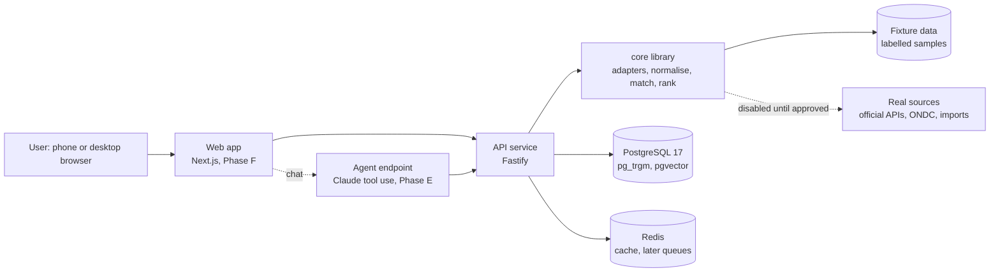
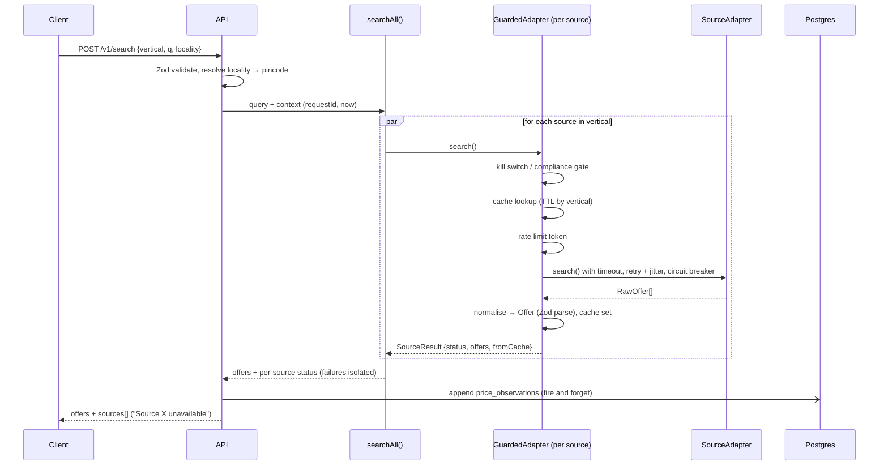

# 03 · Architecture

## System context

## Search data flow

## Layers

| Layer | Package | Responsibility |
|-------|---------|----------------|
| Schemas and helpers | `packages/core/src/{schemas,money,units,localities}` | Canonical types (Zod), paise, unit maths, Chennai localities |
| Adapters | `packages/core/src/adapters` | Interface, `FixtureAdapter`, `GuardedAdapter` wrapper, registry |
| Search orchestration | `packages/core/src/search.ts` | Fan out, isolate failures, filter |
| Matching and ranking | `packages/core/src/{match,rank}` | Phase C |
| Persistence | `packages/db` | Drizzle schema, SQL migrations, seed, observation store |
| HTTP | `apps/api` | Fastify routes, OpenAPI, Redis cache, logging, metrics |
| Agent | `apps/api` `/v1/agent` | Phase E |
| UI | `apps/web` | Phase F |

## Key decisions (with rejected alternatives)

Details live in [DECISIONS.md](DECISIONS.md).

| Decision | Chosen | Rejected and why |
|----------|--------|------------------|
| Repo layout | npm workspaces monorepo | Turborepo/Nx: extra tooling not needed at this size. pnpm: npm ships with Node, one less install for a student. |
| API framework | Fastify 5 | NestJS: heavier, decorator-based, more to learn. Express: no built-in schema/OpenAPI story. |
| ORM / migrations | Drizzle (SQL-first) | Prisma: pgvector and pg_trgm need raw SQL anyway, and Drizzle keeps SQL visible for learning. |
| Validation | Zod 4 | io-ts / class-validator: less ergonomic; Zod also produces OpenAPI via the type provider. |
| Cache | Interface with Redis and in-memory versions | Redis only: tests would need a running Redis. |
| Rate limit (per source) | In-process token bucket | Redis token bucket: needed only with more than one API instance (noted for Phase G). |
| Matching | Layered, deterministic first | Embeddings-only: can't explain decisions and merges variants. |
| Failure isolation | `Promise.allSettled` + circuit breaker | Fail-fast: one slow source would ruin every search. |

## Runtime topology (local)

`docker compose up` starts `postgres` (pgvector/pgvector:pg17), `redis` (redis:8-alpine) and `api`.
The `api` container runs migrations and seeds on start, then listens on port 4100.
