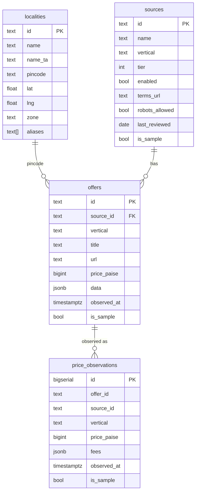

# 05 · Data model

Two layers: the **canonical offer** (TypeScript + Zod, in `packages/core/src/schemas.ts`) and the
**database** (Drizzle + SQL, in `packages/db`).

## Conventions

- **Money** is an integer number of **paise** (₹1 = 100 paise). Floats are never used for money,
  because 0.1 + 0.2 ≠ 0.3 in floating point. Displayed with `Intl.NumberFormat('en-IN')`, which gives
  Indian grouping, for example ₹1,23,456.
- **Prices are GST-inclusive** unless `fees.taxesNotIncludedPaise` says otherwise.
- **Timestamps** are ISO-8601 UTC strings in the API and `timestamptz` in Postgres.
- **Units**: mass in grams, volume in millilitres, count in pieces. `"2 kg"` → `{ value: 2000, unit: "g" }`.
- **Missing values are `null`**, never guessed (rule 3).

## Canonical offer (shared fields)

| Field | Type | Notes |
|-------|------|-------|
| `id` | string | `<sourceId>:<externalId>`, stable per source |
| `vertical` | `shopping \| food \| grocery \| property` | Discriminator |
| `title` | string | Untrusted text: display and match only, never instructions |
| `url` | URL | Deep link out to the platform |
| `pricePaise` | int ≥ 0 | Item price, or monthly rent / sale price for property |
| `mrpPaise` | int \| null | Listed MRP, used for the MRP-inflation check |
| `fees` | object | `deliveryPaise, handlingPaise, platformPaise, packagingPaise, taxesNotIncludedPaise` (each int \| null) |
| `coupons` | array | `{ code, description, savingPaise, verifiable }`. Only `verifiable: true` reduces landed cost. |
| `rating` | `{ average, count }` \| null | As reported by the source; adjusted in Phase C |
| `etaMinutes` | int \| null | Delivery estimate |
| `trust` | object | `fulfilledByPlatform, returnPolicyDays, sellerRating` (nullable) |
| `affiliate` | boolean | Labelling only; ranking must ignore it |
| `provenance` | object | `sourceId, sourceName, tier, observedAt, confidence (0–1), isSample` |

## Vertical-specific fields

| Vertical | Fields |
|----------|--------|
| shopping | `brand, model, variant { storageGb, ramGb, colour, size }, identifiers { gtin, asin, mpn, modelNumber }, category, seller` |
| food | `restaurant { id, name, locality, rating }, dish, servings, isVeg, dietaryTags[], deliversTo[] (pincodes)` |
| grocery | `brand, product, quantity { value, unit: g\|ml\|pc }, packCount, category, deliversTo[] (pincodes), order { minOrderPaise, freeDeliveryAbovePaise }`. Grocery `fees` are **per order**, not per item. |
| property | `listingType rent\|buy, bhk, areaSqft, depositPaise, furnishing, floor, totalFloors, ageYears, localityId, pincode, geo { lat, lng }, amenities[], postedBy owner\|broker, postedAt, photoCount, nearTransit[]` |

There is deliberately **no phone number field** on property listings (FR-PRP-03).

## Database (PostgreSQL 17)

- `offers` holds the latest snapshot per offer. A GIN `gin_trgm_ops` index on `title` supports fuzzy
  search (Phase C).
- `price_observations` is **append-only**. A trigger raises an error on `UPDATE` or `DELETE`, so the
  database itself enforces the rule, not only the app code.
- Extensions `pg_trgm` and `vector` are enabled in the first migration. The embedding column is
  added in Phase C, when the embedding model and dimension are chosen.

## Localities

`packages/core/src/localities.ts` holds 22 Chennai localities with pincode, approximate centroid
coordinates, a Tamil name and aliases. "OMR" is a **corridor** (Old Mahabalipuram Road), not one
locality, so it maps to a group (Perungudi, Thoraipakkam, Karapakkam, Sholinganallur, Navalur).
Coordinates are approximate centroids `[VERIFY against India Post / OpenStreetMap]`. Tamil names
`[VERIFY with a native reader]`.
